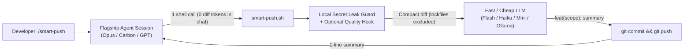

# smart-push (`/smart-push`)

> **Zero-context-bloat, provider-agnostic Git commit & push [Agent Skill](https://agentskills.io) and CLI.**

When you ask an AI coding assistant (Claude Code, Google Antigravity, GitHub Copilot, Cursor, OpenAI Codex) to *"commit and push"*, the flagship model typically runs `git status` and `git diff`, pulling **hundreds or thousands of diff lines straight into your active conversation context**. You pay flagship token rates not just once, but on **every subsequent turn** of that session—just to write a 50-character Conventional Commit message.

**`smart-push` fixes this:**
1. **`0` Diff Tokens in Your Main Chat:** The `/smart-push` skill instructs your coding agent **never** to read `git diff`. Instead, it invokes `scripts/smart-push.sh` in a single command.
2. **Automatic Low-Cost Model Selection:** `smart-push.sh` auto-detects your existing AI CLIs (`agy`, `claude`, `gemini`, `codex`, `ollama`) **or** API keys (`GEMINI_API_KEY`, `OPENAI_API_KEY`, `ANTHROPIC_API_KEY`, `OPENROUTER_API_KEY`) and generates a clean [Conventional Commit](https://www.conventionalcommits.org/) using the fastest, cheapest model tier (`flash-lite`, `flash-low`, `gpt-4o-mini`, `haiku`, or local Ollama).
3. **Pre-LLM Secret Leak Guard:** Scans staged diffs locally for private keys, API tokens, and `.env` files **before** sending a single byte to any external LLM or creating a commit.

---

## Architecture



---

## Real-World Token Benchmark (Identical Diff in a Live 105k-Token Session)

Measured in a real active coding session (`~105k` existing context tokens on a flagship model) committing this repository's initial codebase (**10 files, 1,001 lines, `40,433` bytes of Git diff**):

| Metric | Native Agent Push<br/>*(in Flagship Chat)* | `/smart-push` Skill<br/>*(in Flagship Chat)* | `git smart-push`<br/>*(Terminal CLI)* |
| :--- | ---: | ---: | ---: |
| **Flagship Model Turns** | `3` turns | **`2` turns** (`-33%`) | **`0` turns** (`-100%`) |
| **Flagship Uncached Input Tokens** | `9,068` | **`~4,950`** (`-45%`) | **`0`** (`-100%`) |
| **Flagship Cache-Read Tokens** | `322,696` | **`~206,365`** (`-36%`) | **`0`** (`-100%`) |
| **Flagship Output Tokens** | `681` | **`~350`** (`-49%`) | **`0`** (`-100%`) |
| **Low-Cost Model Sub-Call Tokens** | `0` | `15,131` in / `13` out *(CLI)*<br/>`~3,200` in / `13` out *(REST API)* | `15,131` in / `13` out *(CLI)*<br/>`~3,200` in / `13` out *(REST API)* |
| **Permanent Diff Context Added to Chat** | **`+3,604` to `+10,500` tokens** | **`~120` tokens** (`-97%+`) | **`0` tokens** (`-100%`) |
| **Extra Flagship Tokens Over Next 10 Turns** | `+36,040` to `+105,000` | **`~1,200`** | **`0`** |
| **Est. Cost (Push + 10 Follow-up Turns)*** | **`~$0.145 – $0.166`** | **`~$0.079`** (`~2x` cheaper) | **`~$0.0005 – $0.002`** (`>70x` cheaper, `$0` w/ Ollama) |

*\*Estimated at representative flagship rates (`$3.00/1M` input, `$0.30/1M` cached input, `$15.00/1M` output) vs. mini/flash-lite rates (`$0.15/1M` input, `$0.60/1M` output). Full step-by-step telemetry and reproduction guide in [`benchmarks/BENCHMARK.md`](./benchmarks/BENCHMARK.md).*

---

## Installation

### Option 1: Universal Agent Skills CLI (`npx skills`)
Works with Claude Code, Cursor, GitHub Copilot, Windsurf, Codex, and Antigravity:

```bash
npx skills add steierma/smart-push
```

> **GitHub Copilot note:**
> - With `npx skills`, you can target Copilot directly via `npx skills add steierma/smart-push --agent copilot`.
> - With Copilot CLI `/skills add <path>`, point to the `skills/smart-push` subdirectory (the folder containing `SKILL.md`), **not** the repository root.
> - Alternatively, copy or symlink `skills/smart-push` into `.github/skills/smart-push` (project) or `~/.copilot/skills/smart-push` (personal, also handled by `install.sh`).

### Option 2: Google Antigravity (`agy`) Plugin
```bash
agy plugin install https://github.com/steierma/smart-push
```

### Option 3: Clone + Symlink Installer (Agent Skill + Terminal `git smart-push`)
Installs `/smart-push` globally for your installed AI agents **and** adds `smart-push` / `git smart-push` to your shell:

```bash
git clone https://github.com/steierma/smart-push.git ~/.local/share/smart-push
~/.local/share/smart-push/install.sh
```

---

## Usage

### Inside Any AI Coding Agent
Simply type:
```text
/smart-push
```

### Directly in Your Terminal (No Active Agent Session Needed)
```bash
# Interactive confirmation ([Y/n/edit])
git smart-push

# Non-interactive commit & push
smart-push --yes

# Preview generated Conventional Commit without committing
smart-push --dry-run

# Force a specific scope or provider
smart-push --scope auth --provider ollama --model qwen2.5-coder:3b

# Push a specific sub-repository or all dirty sub-repositories in a multi-repo workspace
git smart-push services/auth
git smart-push --all-subrepos
```

---

## Provider Auto-Detection Order (`--provider auto`)

`smart-push` requires **zero extra configuration** if you already have an API key exported or an AI CLI logged in:

| Priority | Provider (`--provider`) | Trigger | Default Fast Model (`--model`) |
| :---: | :--- | :--- | :--- |
| 1 | `gemini-api` | `$GEMINI_API_KEY` | `gemini-2.5-flash-lite` |
| 2 | `openai-api` | `$OPENAI_API_KEY` (supports `$OPENAI_BASE_URL`) | `gpt-4o-mini` |
| 3 | `anthropic-api` | `$ANTHROPIC_API_KEY` | `claude-3-5-haiku-latest` |
| 4 | `openrouter-api` | `$OPENROUTER_API_KEY` | `google/gemini-2.5-flash-lite` |
| 5 | `agy` | `agy` CLI in `$PATH` | `gemini-3.8-flash-low` |
| 6 | `claude` | `claude` CLI in `$PATH` | `haiku` |
| 7 | `gemini-cli` | `gemini` CLI in `$PATH` | `gemini-2.5-flash` |
| 8 | `codex` | `codex` CLI in `$PATH` | `codex-mini` |
| 9 | `ollama` | `ollama` CLI in `$PATH` (`$OLLAMA_HOST`) | `qwen2.5-coder:3b` |

---

## Built-in Safety Features

* **Pre-LLM Secret Leak Guard:** Blocks private keys (`BEGIN * PRIVATE KEY`), GitHub PATs (`ghp_*`, `github_pat_*`), OpenAI keys (`sk-*`), Anthropic keys (`sk-ant-*`), AWS keys (`AKIA*`), Slack tokens (`xox*`), and `.env` files *before* invoking any external LLM or creating a commit.
* **Partial Index Preservation:** If you staged specific hunks (`git add -p`), `smart-push` commits **only** what you staged. If nothing is staged yet, it stages modified/untracked files automatically (`git add -A`).
* **Lockfile Noise Stripping:** Excludes bulky lockfile diffs (`package-lock.json`, `pnpm-lock.yaml`, `yarn.lock`, `Cargo.lock`, `go.sum`, `pubspec.lock`, `poetry.lock`) while keeping file stats so commit generation stays fast and cheap.
* **Custom Quality Hook:** Place an executable `.smart-push-check.sh` in your repository root (or set `SMART_PUSH_CHECK_CMD="make test"`) to enforce lint/tests prior to every commit.

---

## License

[MIT](./LICENSE)
